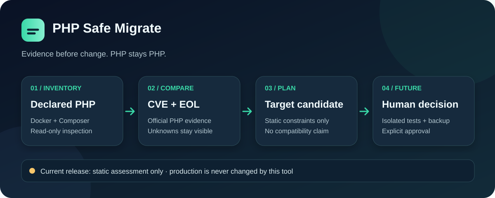

# PHP Safe Migrate

[日本語 README](README.md)



**Find known PHP runtime risks before planning an upgrade. Keep PHP as PHP.** The default scanner reads Docker and Composer metadata, compares declared PHP versions with official release information and a curated advisory catalog, and produces a reviewable report. It does not run application code or edit the project. A separate, explicit Docker command runs a limited test probe on a disposable copy. Neither command deploys to production.

[](https://github.com/FORIFOR/php-safe-migrate/actions/workflows/ci.yml) · [Apache-2.0](LICENSE) · [日本語の企業向け評価ガイド](docs/ENTERPRISE_EVALUATION.ja.md)

## See the assessment


[Watch the short MP4](assets/demo.mp4) · [Inspect the reproducible demo fixture](examples/demo-project/) · [Read the effectiveness check](docs/VALIDATION.md)

The animation uses disposable text fixtures. For the PHP project's [21 October 2026 advisory](https://www.php.net/archive/2026.php#2026-10-21-5), declared `php:8.3.35-fpm` matches the two curated CVEs; `php:8.3.36-fpm` clears that catalog match but remains **unverified**. A changed Dockerfile tag is not evidence that the deployed runtime or application is safe.

## Try it in a few minutes

Python 3.11 or newer:

```sh
git clone https://github.com/FORIFOR/php-safe-migrate.git
cd php-safe-migrate
python -m pip install -e .
php-safe-migrate examples/demo-project --refresh --format markdown
php-safe-migrate /path/to/your/php-project --refresh --format json > assessment.json
```

`--refresh` downloads current support dates and latest release information from php.net. Without it, the bundled snapshot is used and becomes a blocker after 30 days. Review `assessment.json` before sharing it: internal image and package names may appear. The tool writes only to stdout and does not modify the target project.

## Use it for a pilot

Start with one non-production repository. Compare the report with the actual deployed PHP version and your vendor's advisories, then run your existing tests in an isolated environment. The [enterprise evaluation guide](docs/ENTERPRISE_EVALUATION.md) provides a pilot checklist, success criteria, privacy notes, and a [redacted feedback form](https://github.com/FORIFOR/php-safe-migrate/issues/new?template=pilot_feedback.yml). Ask evaluation questions in [Discussions](https://github.com/FORIFOR/php-safe-migrate/discussions).

## What works today

| Area | State |
| --- | --- |
| PHP official support dates and latest releases | Implemented; HTTPS refresh and dated snapshot |
| CVE and version matching | Implemented for a **curated, incomplete** official-source catalog |
| EOL detection | Implemented for official supported branches; other branches flagged |
| Composer and Docker inventory | Static subset; ambiguous inputs remain blockers |
| JSON and Markdown reports | Implemented |
| Target version candidates | Static PHP constraints only; no compatibility assurance |
| Isolated compatibility checks | Limited extension, explicit PHP probe, and locked Composer platform checks; see the [Japanese guide](docs/ISOLATED_VERIFICATION.ja.md) |
| Patch generation, HTTP/DB comparison, rollout | Planned |

The scanner reads only root-level `composer.json`, `composer.lock`, `Dockerfile`, and common Compose filenames. It rejects symlinks and oversized files. It never invokes Composer, PHP, Docker, or project scripts. Exit code `2` indicates findings or blockers; `3` indicates invalid input. Exit code `0` is reserved for a future fully verified assessment and is not currently returned. **No report from the current release is approval to deploy.**

Read the [specification](docs/SPEC.md), [security policy](SECURITY.md), and [dependency license review](docs/LICENSE_REVIEW.md). The original prototype source, tests, and specification are preserved in `docs/prototype/` and `docs/PROTOTYPE_SPEC.md`; the archived CLI is not installed.

## Contribute

See [CONTRIBUTING.md](CONTRIBUTING.md) for development commands and proposed work. Reproducible false negatives, unsupported Composer constraints, Docker/Compose layouts, and safe validation designs are especially useful. Do not post confidential project data or security vulnerabilities in public issues.
