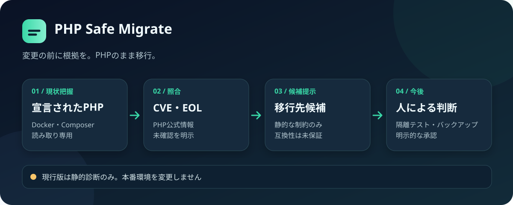
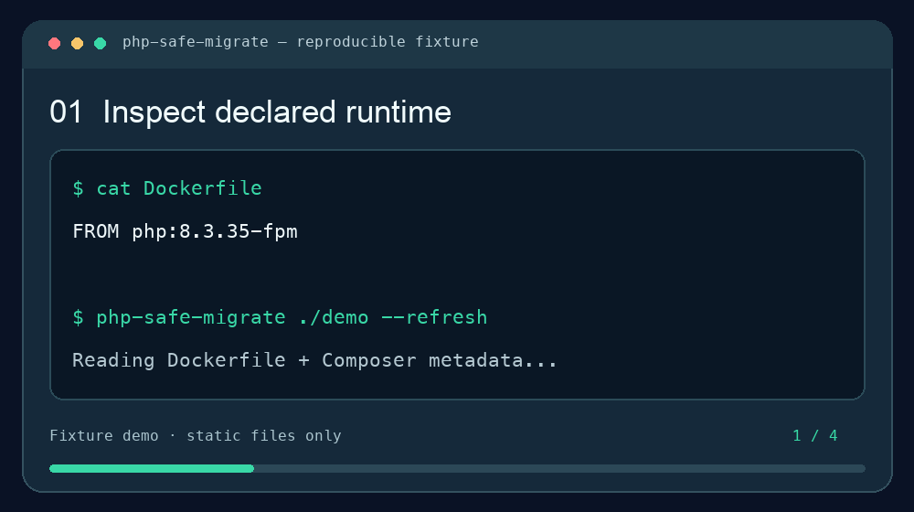

# PHP Safe Migrate

**脆弱なPHP環境を、安全性を確認しながら移行するためのOSSプロジェクトです。** 中心となる**読み取り専用の静的診断ツール**は、DockerとComposerの設定から宣言されたPHP版を調べ、PHP公式のサポート情報と収録済みのCVEに照らして、調査すべき点と移行先候補をレポートします。別コマンドで、非本番の検証用コピーを隔離コンテナで確認する限定的な機能もあります。

PHPのコードをGoやRustへ変換したり、LLMでアプリケーションを書き換えたりしません。通常の診断コマンドは対象のPHPコード、Composerスクリプト、Dockerイメージを実行せず、設定ファイルや本番環境も変更しません。隔離検証コマンドは明示的に指定したPHPテストをコンテナ内で実行します。

[English README](README.en.md) · [](https://github.com/FORIFOR/php-safe-migrate/actions/workflows/ci.yml) · [Apache-2.0](LICENSE)



> **現行版の境界:** レポートは「移行して安全」という承認ではありません。CVEカタログは網羅的ではなく、実際に稼働しているPHP版、アプリケーションの互換性、データ保全は別途検証が必要です。

## まずデモで試す

Python 3.11以降を用意してください。以下はmacOS・Linux向けの例です。

```sh
git clone https://github.com/FORIFOR/php-safe-migrate.git
cd php-safe-migrate
python3.11 -m venv .venv
. .venv/bin/activate
python -m pip install -e .
php-safe-migrate examples/demo-project --refresh --format markdown
```

`examples/demo-project`は、PHP公式が修正対象として示した`php:8.3.35-fpm`を宣言する**説明用のテキスト**です。ビルド・デプロイしないでください。診断結果には、収録済みの`CVE-2026-109618`と`CVE-2026-109619`、修正版`8.3.36`、未検証事項が表示されます。修正版の根拠は[PHP公式の2026年10月21日付勧告](https://www.php.net/archive/2026.php#2026-10-21-5)です。



[MP4で見る](assets/demo.mp4) · [デモ用ファイルを見る](examples/demo-project/) · [検証結果を見る](docs/VALIDATION.md)

このアニメーションは説明用フィクスチャの結果を示します。Dockerfileの宣言を`8.3.36`に変えても、結果は「安全」ではなく`unverified`（未検証）です。

## 自社プロジェクトを診断する

まず本番秘密情報を含まないリポジトリを選び、管理された評価環境で実行してください。

```sh
php-safe-migrate /path/to/php-project --refresh --format json > assessment.json
php-safe-migrate /path/to/php-project --refresh --format markdown > assessment.md
```

`--refresh`は、php.netから**サポート期限と最新リリース情報**を取得します。CVEカタログ全体を自動更新する機能ではありません。指定しなければ同梱の取得日時付きスナップショットを使い、30日を超えると未確認事項として報告します。レポートは標準出力に書き、対象プロジェクトのファイルは変更しません。

現在読み取るのは、プロジェクト直下の`Dockerfile`、一般的な名前のComposeファイル、`composer.json`、`composer.lock`です。シンボリックリンクと大きすぎる入力は拒否します。サブディレクトリのDockerfile、実際に配備されたイメージのdigest、OSベンダーのバックポートは確定できません。

### 結果の読み方

| 項目 | 意味 |
| --- | --- |
| `findings` | 収録済みCVEとの一致や、PHP公式のサポート外・不明な系列など、対応を要する検出結果 |
| `blockers` | PHP版が未確定、拡張の互換性が未検証など、安全性を判断できない理由 |
| `candidate_targets` | PHPの既知の静的制約に合う移行先候補。アプリの動作保証ではありません |
| `action_required` | 既知の問題が検出された状態 |
| `unverified` | 収録済みの問題には一致しないが、安全性は確認できていない状態 |

終了コード`2`は検出結果または未解決の確認事項があることを示します。`3`は入力エラーです。`0`は将来の十分な検証を伴う診断用に予約されており、現行の静的診断では返しません。CIで`2`を「移行失敗」や`unverified`を「本番投入可」と読み替えないでください。

## 企業で評価する場合

1. 非本番のPHPリポジトリ1件で診断し、レポートを関係者と確認します。
2. 実際に稼働しているPHP版・イメージdigestと、利用中のベンダーの修正情報を別途照合します。
3. 候補版でのComposer依存関係、拡張、既存テスト、HTTP応答、DBの整合性を**自社の隔離環境**で検証します。
4. バックアップと復旧を確認し、本番変更には別途明示的な承認を設けます。

詳しい手順と評価基準は[企業向け評価ガイド](docs/ENTERPRISE_EVALUATION.ja.md)にまとめています。効果や誤検出は、機密情報を除いたうえで[評価フィードバック](https://github.com/FORIFOR/php-safe-migrate/issues/new?template=pilot_feedback.yml)に共有してください。質問は[Discussions](https://github.com/FORIFOR/php-safe-migrate/discussions)、脆弱性報告は[非公開のSecurity Advisory](https://github.com/FORIFOR/php-safe-migrate/security/advisories/new)をご利用ください。

非本番の検証用コピーでは、[隔離環境での限定的な互換性検証](docs/ISOLATED_VERIFICATION.ja.md)を試せます。ローカルの旧版・新版PHPイメージで拡張と指定したPHPテストを実行し、Composer PHARとロックファイルがあればプラットフォーム要件も確認します。結果は本番投入の承認ではありません。

ツールにはテレメトリーはありません。`--refresh`を指定した場合のみPHP公式サイトへ接続します。ただし、レポートには社内のイメージ名やComposerパッケージ名が含まれ得ます。外部へ共有する前に内容を確認してください。

## 実装状況

| 分野 | 現在の状態 |
| --- | --- |
| PHP公式のサポート期限・最新リリース取得 | 実装済み。HTTPSで取得、同梱スナップショットあり |
| CVE・影響版・EOLの照合 | 一部実装。**収録済みのCVEに限定** |
| ComposerとDockerの解析 | 静的解析の一部を実装。曖昧な入力は未検証扱い |
| JSON・Markdownレポート | 実装済み |
| 移行先候補 | PHP版の静的制約に基づく提案のみ |
| パッチ生成 | 未実装 |
| 隔離環境での互換性検証 | PHP拡張・指定テスト・Composerプラットフォーム要件の一部を実装 |
| 動作・データ比較、段階的切替、ロールバック | 未実装 |

[検証記録](docs/VALIDATION.md)では、PHP公式が示す8.2〜8.5の修正境界など11ケースの静的判断が期待どおりだったことを再現できます。**実運用での移行成功を示す結果ではありません。** 設計上の制約と今後の実装は[仕様書](docs/SPEC.md)を参照してください。

## 開発・ライセンス

```sh
python -m pip install -e '.[dev]'
ruff check src/phpsafe tests scripts
pytest -q
```

[貢献ガイド](CONTRIBUTING.md)に、再現用サンプルや安全性を保つ実装方針を記載しています。ライセンスは[Apache-2.0](LICENSE)です。直接依存する開発ツールの確認結果は[ライセンス確認記録](docs/LICENSE_REVIEW.md)にあります。元の試作コード・テスト・仕様は`docs/prototype/`と`docs/PROTOTYPE_SPEC.md`に資料として保存しており、試作CLIはインストールされません。
